# Sable


**Sable** is an open-source video player for iPhone. It is built natively in Swift and SwiftUI for
iOS 18+, with a black pixel-art interface. It translates whole subtitle tracks from English to
Arabic, has precise manual subtitle timing, and offers a guided way to sync subtitles that run
early or late.

- Plays the files you already have: MP4/MOV/M4V with Apple's hardware-accelerated AVFoundation
  engine, and MKV, WebM, AVI and more with an embedded VLC engine (libVLC 3).
- Translates **a whole subtitle track at once** into Arabic that renders correctly from right to
  left, using free, private on-device translation, Claude with your own Anthropic key, or your
  ChatGPT Plus or Pro plan ("Sign in with ChatGPT", an OpenAI preview).
- Fixes subtitle timing in milliseconds, by hand or by marking one spoken line.

No Sable account, no tracking, no Sable server. MIT-licensed.

---

## Contents

[Features](#features) ·
[Screenshots](#screenshots) ·
[Formats and codecs](#format--codec-support) ·
[Subtitles](#subtitles) ·
[Translation](#translation) ·
[Timing and guided sync](#timing--guided-sync) ·
[Picture in Picture](#picture-in-picture) ·
[Install the IPA](#installing-the-unsigned-ipa) ·
[Build from source](#building-from-source) ·
[CI](#continuous-integration) ·
[Project structure](#project-structure) ·
[Licenses](#licenses)

## Features

**Library**
- Import videos from the Files app. Sable copies them into its library, so files from iCloud Drive
  or a USB drive stay playable.
- Thumbnails, durations, watched-progress bars, search, and sorting by date added, last played,
  title, duration or size. Removing a video deletes its media, thumbnail, subtitle files,
  translated tracks, extracted-subtitle cache and timing (translation checkpoints and cached
  results are kept; Settings shows their size).

**Playback**
- Two engines, chosen per file: **AVFoundation** for MP4/MOV/M4V/3GP files that iOS reports as
  playable, with hardware decoding and Picture in Picture, and **VLC** (MobileVLCKit 3.7.5 /
  libVLC 3) for everything else, including files AVFoundation fails on. You can force VLC for all
  files in Settings.
- Play/pause, a scrubber with a precise timecode bubble, skip buttons, and double-tap on the left
  or right third of the video to seek (5/10/15/30 s, configurable; the middle third toggles play).
  Horizontal pan scrubs, vertical pan on the left half sets brightness, pinch switches Fit/Fill.
- Speed from 0.5× to 2×, aspect modes (Fit, Fill, Stretch, 16:9, 4:3, 21:9), audio track switching.
- In the background, AVFoundation playback continues in Picture in Picture; VLC playback pauses.
- Remembers per video: position (resume), speed, audio and subtitle track, aspect, subtitle style.

**Subtitles**
- Embedded text tracks in MKV/WebM (SRT, ASS/SSA, WebVTT) and MP4 (`tx3g`/`mov_text`), plus
  external SRT, WebVTT, ASS and SSA files.
- Drawn by Sable on both engines, with adjustable size (60–200 %), outline/shadow/box background
  and font. Arabic is always set in IBM Plex Sans Arabic, right to left.
- Image-based tracks (PGS/VobSub/DVB) are labelled and rendered natively by the VLC engine; they
  cannot be translated or re-timed.

**Translation**
- Whole-track English→Arabic translation that produces a new track with identical timing.
- Apple on-device (free, private) or Claude (your own Anthropic key, billed to you, confirmation
  with a cost estimate before every job).
- ChatGPT plan (OpenAI preview): **Sign in with ChatGPT** and translate with your ChatGPT Plus or
  Pro plan. Requests count toward your ChatGPT usage limits (on Plus, the 5-hour limit is shared
  with other apps); it is not OpenAI API access, and Sable charges nothing. A confirmation comes
  before every job, and the usage limit offers Manage usage and Resume.
- Chunked with context and a glossary, validated line by line, resumable after cancel or crash,
  and cached.
- Export the Arabic track as SRT, optionally with the current offset baked in and with RTL marks.

**Timing and sync**
- Manual offset: ±0.1 s / ±1 s buttons, typed values ("-2.5", "1:02.5", "250ms"), reset and
  50-step undo, saved per video and track.
- Guided sync: mark the moment a line is spoken, pick the line, and Sable computes the offset. An
  optional second point corrects drift.
- An English track and its Arabic translation share one timing.

**Interface**
- True-black OLED design with one amber accent, crisp integer-scaled pixel icons, and pixel fonts
  for the interface.
- 44-pt touch targets, VoiceOver labels and Dynamic Type throughout.

## Screenshots

Captured automatically by the simulator UI tests on GitHub Actions (iPhone simulator, Debug build
with the bundled sample clips and the offline mock translator). They are not from a physical device.

| Library | Player | Subtitle tracks | Arabic subtitles |
|---|---|---|---|
| 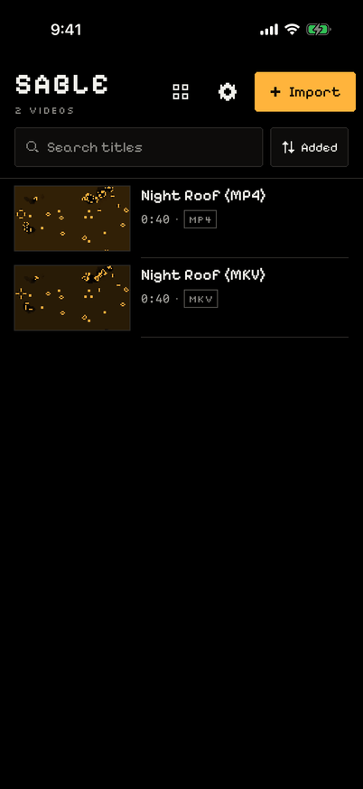 | 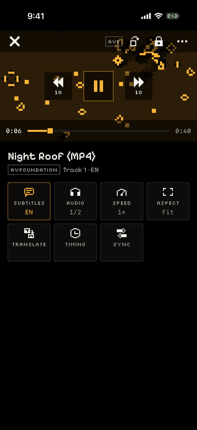 | 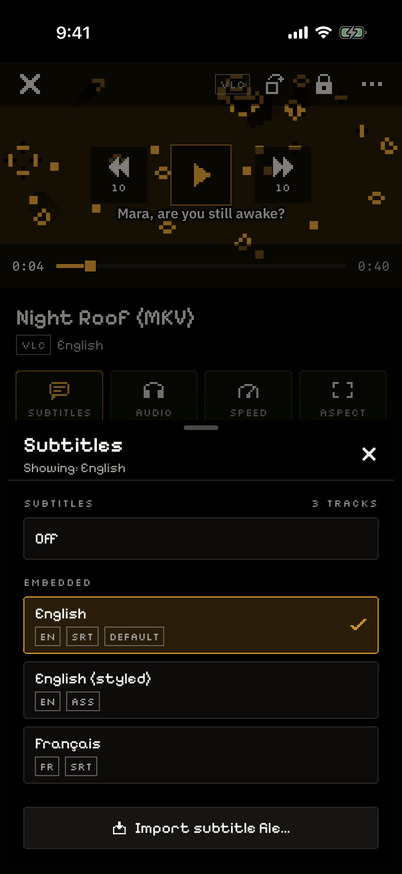 | 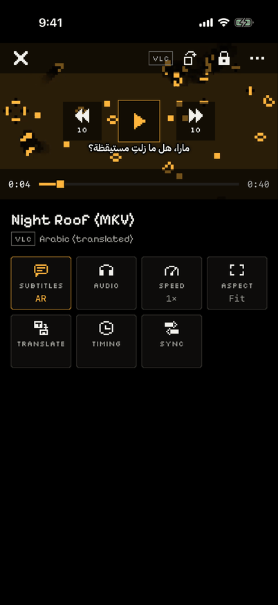 |

| Translation | Timing | Guided sync | Settings |
|---|---|---|---|
| 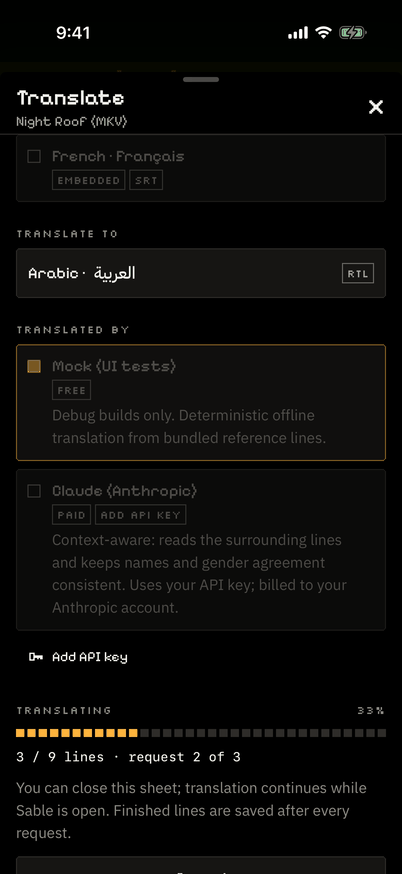 | 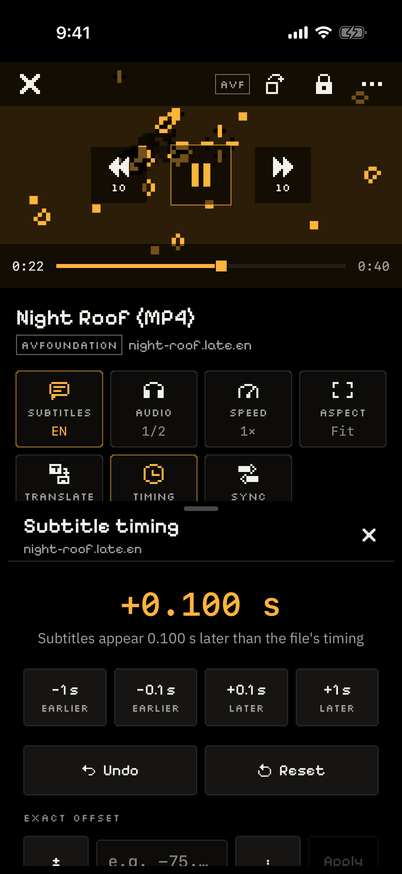 | 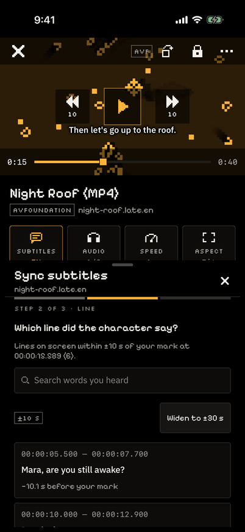 | 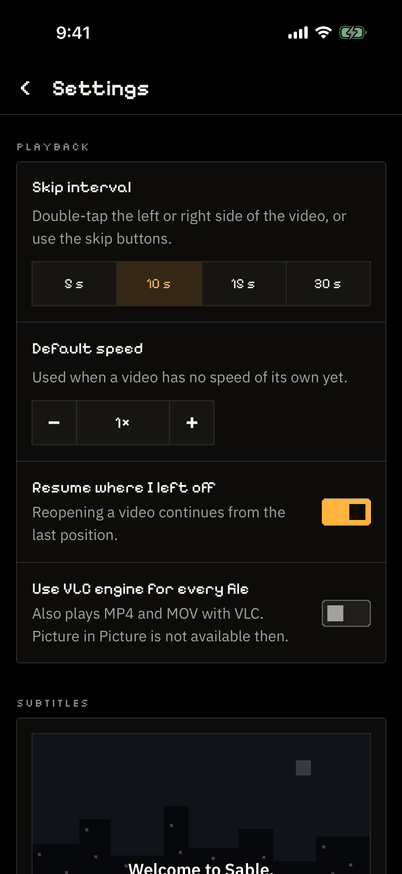 |

| External subtitles (switched during playback) | Sign in with ChatGPT |
|---|---|
| 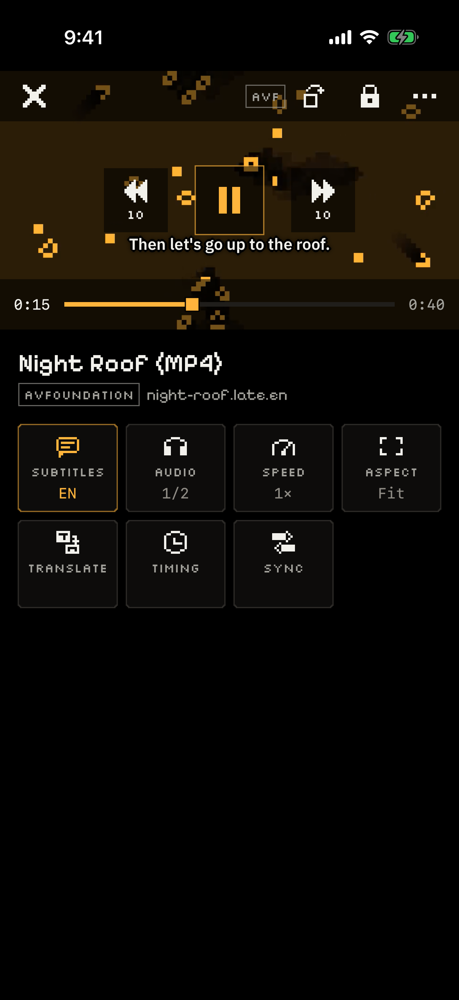 | 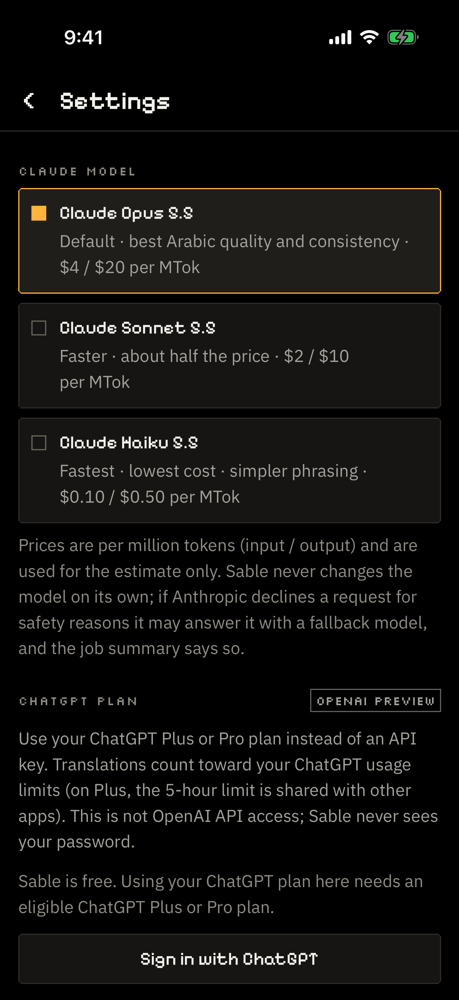 |

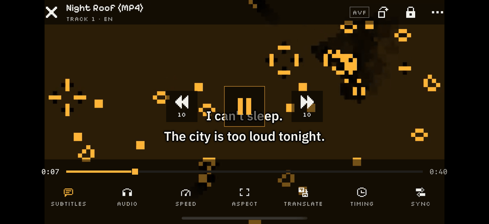

## Format & codec support

Sable picks the engine per file:

1. It reads the file's first bytes. An EBML header means Matroska/WebM; an `ftyp` box means the MP4
   family (MP4, MOV, M4V, 3GP). Older QuickTime files are recognised by their atoms only when the
   extension agrees; anything else is judged by its extension.
2. MP4-family files are opened with `AVURLAsset`. If iOS reports the file as playable
   (`isPlayable`), AVFoundation plays it. Everything else goes to VLC.
3. If AVFoundation fails to open the file, or fails within the first 2 s of playback, Sable switches
   to VLC and says so. The player's **More** sheet also offers *Reopen with VLC* and *Reopen with
   AVFoundation*.

Settings › *Use VLC engine for every file* forces VLC, which also removes Picture in Picture.

| | AVFoundation engine | VLC engine (MobileVLCKit 3.7.5 / libVLC 3) |
|---|---|---|
| **Containers** | MP4, MOV (QuickTime), M4V, 3GP | MKV, WebM, AVI, MPEG-TS/M2TS/PS, FLV, OGG/OGM, ASF/WMV, and MP4/MOV as fallback |
| **Video** | H.264, HEVC and (device-dependent) ProRes, hardware-decoded; AV1 only on iPhones with AV1 hardware decoding (iPhone 15 Pro and later) | H.264 and HEVC (hardware via VideoToolbox), VP8/VP9, AV1 (software, dav1d), MPEG-1/2, MPEG-4 Part 2 (DivX/Xvid), VC-1/WMV, Theora |
| **Audio** | AAC, ALAC, MP3, AC-3, E-AC-3 | AAC, MP3, AC-3/E-AC-3, DTS, TrueHD, FLAC, Opus, Vorbis, ALAC, WMA, PCM |
| **Text subtitles** | drawn by Sable (embedded `tx3g`/`mov_text` + external files) | drawn by Sable (embedded SRT/ASS/SSA/WebVTT + external files) |
| **Image subtitles** | not listed (image tracks in MP4 are not detected) | PGS, VobSub, DVB rendered natively by VLC |
| **Picture in Picture** | yes | no |
| **In the background** | continues in Picture in Picture | pauses |
| **Hardware decoding** | yes | H.264/HEVC via VideoToolbox; other codecs in software |

Honest notes:
- **Where the codec lists come from:** libVLC 3's module set and AVFoundation's documented
  support. They were not checked codec by codec on a device, and the MobileVLCKit binary was not
  audited for missing modules.
- Software decoding (VP9, AV1 on most iPhones, high-bitrate MPEG-2) uses more battery and can drop
  frames on 4K material.
- HDR and Dolby Vision have not been tested. AVFoundation is Apple's HDR path; libVLC 3 has no
  Dolby Vision support, so profile 5 files typically show wrong colours with VLC.
- A remembered audio track is restored only when the same engine opens the file again (the two
  engines number tracks differently).
- DRM-protected files (for example FairPlay-protected iTunes purchases) cannot be played; Sable says
  so instead of trying.

## Subtitles

| Format | External file | Embedded in MKV/WebM | Embedded in MP4 | Translatable / guided sync |
|---|---|---|---|---|
| SRT (SubRip) | yes | yes (`S_TEXT/UTF8`) | n/a | yes |
| WebVTT | yes | yes (`S_TEXT/WEBVTT`, `D_WEBVTT/*`) | `wvtt` decoded, untested on real files | yes |
| ASS / SSA | yes | yes (`S_TEXT/ASS`, `S_TEXT/SSA`) | n/a | yes |
| MP4 timed text (`tx3g`/`mov_text`) | n/a | n/a | yes | yes |
| PGS / VobSub / DVB (image) | n/a | listed; VLC renders them | not listed | **no** (needs OCR) |
| CEA-608/708 captions | n/a | n/a | listed as unsupported | no |

- **Text encodings** are detected automatically: UTF-8 (with or without BOM), UTF-16 (with BOM, or
  without when its byte pattern is clear), UTF-32 with BOM, Windows-1256 (Arabic), Windows-1252 and
  ISO-8859-1. Other code pages (Windows-1251, Windows-1255, GBK, Shift-JIS) show garbled text.
- **Formatting is simplified on purpose.** Kept: line breaks, `<i>`, `<b>`, `<u>`, and an alignment
  hint (`\an8` "top", middle, left/right for Latin text). Dropped: colours, fonts, sizes,
  positioning (`\pos`, `\move`, WebVTT regions), fades, transforms, karaoke, borders, shadows,
  blur, rotation, scaling, margins, drawings and CSS. Sable's own subtitle style applies instead,
  so typeset signs show as plain text.
- **Image-based subtitles** (PGS from Blu-ray, VobSub from DVD, DVB) are pictures, not text. Sable
  cannot read them, because OCR is **not implemented**. They are labelled `IMAGE`, rendered
  natively by the VLC engine (Sable's overlay is not used), and are not offered for translation,
  guided sync or timing adjustment. Import a text (SRT) version to translate or re-time them.
- **Default track:** if you never chose a track for a video, Sable selects the embedded text track
  flagged *default* (otherwise the first English one). Turning subtitles off is remembered.

Details: [docs/SUBTITLES.md](docs/SUBTITLES.md).

## Translation

Open **Translate** in the player and choose the source track and the provider. Sable translates the
**whole track** and saves it as a new track, "Arabic (translated)". The new track has the same
lines and timestamps as the source, which is never modified.

| | Apple on-device | Claude (Anthropic) |
|---|---|---|
| Cost | free | **billed to your Anthropic account** (your own API key) |
| Privacy | subtitle text never leaves the iPhone | only the subtitle text is sent to Anthropic's API under your account; nothing goes to Sable |
| Method | batches of 20 lines, each line translated on its own (no context) | 40 lines per request with 6 lines of context on each side and a running glossary of names/terms |
| Model | Apple's on-device model | Claude Opus 5.5 by default (Sonnet 5.5 or Haiku 5.5 selectable), effort `medium` |
| Quality | fine for simple dialogue; names, gender agreement and tone can vary | consistent names, gender and register; idiomatic subtitles |
| Before it runs | nothing to confirm | **a confirmation before every job** shows the model and price, lines, requests, estimated tokens and an approximate cost range |
| Requirements | the Translate sheet must stay open; iOS may download the language assets first; **does not work in the Simulator** | paste your API key in Settings › Translation; it is stored only in the iOS **Keychain** (this device only), never in files, settings or logs |

How it works:
- **Chunking:** each Claude request carries 6 earlier lines (with their translations) and 6 later
  lines as read-only context, plus the glossary entries relevant to that chunk.
- **Validation and repair:** every line must come back exactly once with its id. Missing lines are
  re-requested (twice), then the chunk is split in halves, so a translation never shifts lines or
  silently drops one. Truncated replies are split at once; rate limits and server errors are retried
  with backoff.
- **Refusals:** requests enable Anthropic's server-side refusal fallbacks; an answer from a
  fallback model is reported, never hidden.
- **Resume:** a checkpoint is saved after every chunk. Cancel at any time, or lose the app to a
  crash. **Resume** continues where it stopped, and finished lines are never sent (or billed) again.
- **Cache:** a finished translation is cached per source content, target, provider and model.
  Translating the same track again is instant and free.
- **Export:** `Documents/Exports/<title>.ar.srt` (visible in the Files app under *On My iPhone ›
  Sable*), UTF-8 with BOM, with optional RTL marks and the optional current offset.
- **Cost example:** an 840-line track with Opus 5.5 is estimated at about 60k input and 18k output
  tokens over 21 requests, roughly $0.50–$1.20. Sonnet 5.5 is about half that; Haiku 5.5 a few
  cents. The estimate is approximate; Anthropic bills your account at its current prices.
- The translated track shares the source's timing, so an offset fixed on English also fixes the
  Arabic.

**ChatGPT plan (OpenAI preview).** In Settings › Translation, **Sign in with ChatGPT** opens
OpenAI's sign-in page in a browser sheet; the redirect comes back to a small receiver Sable runs on
`127.0.0.1` on the iPhone, and the tokens are stored only in the Keychain (this device only). It
needs an eligible ChatGPT **Plus or Pro** plan. Translations count toward your ChatGPT usage limits
(on Plus, the 5-hour limit is shared with other apps) and may use credits if you allowed credits
for apps in ChatGPT settings; it is **not** OpenAI API access or API billing, and Sable charges
nothing. The model is one your account offers (the first listed until you pick another); "Using
ChatGPT plan" and **Manage usage** are shown next to it, a confirmation comes before every job, and when the limit is reached the job keeps its
finished lines with **Manage usage** and **Resume**. The button is a text label only; Sable bundles
no OpenAI or ChatGPT logo.

Details, including errors and the mock provider used by the tests:
[docs/TRANSLATION.md](docs/TRANSLATION.md).

## Timing & guided sync

**Positive offset = subtitles appear later.** Original cue times are never modified. The
correction (`effective = original × scale + offset`) is applied when cues are drawn and, if you
choose, when you export.

- **Manual:** open **Timing** while the video plays; the sheet leaves the video visible. Use
  −1 / −0.1 / +0.1 / +1 s (hold to repeat), or type an exact offset of any size (`-2.5`, `+0.25`,
  `1:02.5`, `-1:02:03.25`, `250ms`, `-2s`, `0,5`) and apply it. Undo (50 steps) and Reset (itself
  undoable) are always available. Timing is saved per video and timing group: a translation shares
  its source track's timing.
- **Guided sync:** open **Sync** and tap **Mark speech start** the moment someone starts speaking,
  then refine the mark (±0.01 / ±0.1 s, *Hear it again*). Choose that line from the lines within
  ±10 s of the mark; widen to ±30 s, ±60 s or the whole track, or search. Sable sets
  `offset = mark − the line's original start`. **Apply & preview** plays from 2 s before the mark;
  then **Looks right** or **Undo** (the whole sync is one undo step).
- **Onset suggestion:** for AVFoundation media, Sable can suggest where the speech starts from the
  audio's loudness. It is a heuristic, **not speech recognition**, and is not available with VLC.
- **Drift:** one offset fixes a **constant** delay. Subtitles that **drift** (for example made for a
  25 fps release and played against 23.976 fps, about 4 % slower) need a second point: **Add a
  second point** on a line at least 60 s away, and Sable computes a linear stretch. Scales outside
  0.9–1.1 are rejected.
- Image-based tracks (PGS/VobSub) cannot be re-timed or synced.

Details: [docs/SYNC.md](docs/SYNC.md).

## Picture in Picture

PiP is available **only with the AVFoundation engine**, which handles MP4/MOV/M4V/3GP files iOS can
play. It uses the system PiP controller, so it keeps playing over other apps, and it starts
automatically when you leave Sable while a video is playing. Files played with VLC (MKV, WebM, AVI,
… or everything when *Use VLC engine for every file* is on) have no PiP button, and VLC playback
pauses when Sable goes to the background.

**Sable's subtitles are not shown in the PiP window.** Sable draws subtitles in its own overlay
above the video, and the PiP window shows only the video, so offsets, translations and external
subtitle files are not visible in PiP.

## Installing the unsigned IPA

Each build of `main` publishes **`Sable-unsigned.ipa`** on the
[`latest` pre-release](https://github.com/MuhALmoxx/Sable/releases/tag/latest), with its SHA-256.
Every CI run also uploads `Sable-unsigned-ipa-<sha>` as a workflow artifact.

The IPA is a real **device** build (arm64, iphoneos, MobileVLCKit embedded), but it is **unsigned**:
CI has no signing secrets. **It must be signed before iOS will install it.** Choose one of:

1. **AltStore / SideStore** (with your Apple ID): open the IPA with the app. Free accounts must
   refresh the app every 7 days and can have at most 3 sideloaded apps.
2. **Sideloadly** (macOS/Windows, with your Apple ID): drag in the IPA, sign in and install.
3. **Your own certificate + provisioning profile:** re-sign with `codesign` (framework first, then
   the app) and install it with Xcode or `xcrun devicectl`. Step-by-step commands:
   [docs/SIGNING.md](docs/SIGNING.md).

When `IOS_*` signing secrets are configured (a fork can add its own), CI also builds a signed IPA.
It is uploaded only as a workflow artifact kept for 7 days and is never attached to the public
release, because it contains the provisioning profile (team ID, device UDIDs).

iOS 16+ also requires **Developer Mode** (Settings › Privacy & Security) for sideloaded apps. No
simulator build is distributed as an IPA. For the simulator, build from source.

## Building from source

Requirements: a Mac with **Xcode 26** (iOS 26 SDK; the app targets iOS 18.0+),
[XcodeGen](https://github.com/yonaskolb/XcodeGen) (`brew install xcodegen`), and `curl`/`tar`.

```sh
git clone https://github.com/MuhALmoxx/Sable.git
cd Sable
./scripts/fetch-vlckit.sh     # MobileVLCKit 3.7.5 -> Vendor/ (pinned URL + SHA-256, idempotent)
xcodegen generate             # creates Sable.xcodeproj from project.yml
open Sable.xcodeproj          # select your team under Signing & Capabilities, then Run
```

- Core tests, no Xcode needed (macOS or Linux, Swift 6.1+):
  `swift test --package-path Packages/SableKit`
- App unit + UI tests: `xcodebuild test -project Sable.xcodeproj -scheme Sable -destination 'platform=iOS Simulator,name=iPhone 17 Pro'`
  ([docs/TESTING.md](docs/TESTING.md))
- Unsigned device build, as CI does it:
  `xcodebuild -project Sable.xcodeproj -scheme Sable -configuration Release -sdk iphoneos -destination 'generic/platform=iOS' CODE_SIGNING_ALLOWED=NO build`
- Test fixtures are regenerated with `Fixtures/make_fixtures.sh` (needs ffmpeg).

## Continuous integration

`.github/workflows/ios.yml` runs on every push to every branch. Pushes that touch only docs are
skipped.

| Job | Steps |
|---|---|
| **Core tests (Linux)** | `swift test` for SableKit in the `swift:6.1.2` container |
| **iOS build, tests, IPA** (macOS) | package tests → XcodeGen → **unsigned Release device build** → IPA packaging → **IPA verification** (Payload/Sable.app, arm64 device Mach-O, iOS platform, MobileVLCKit embedded and dynamically linked, `DTPlatformName = iphoneos`, fonts present, no test fixtures) → artifact `Sable-unsigned-ipa-<sha>` → simulator **build-for-testing** (compiles AppTests/UITests on every branch) → on `main` or manual dispatch: **simulator unit + UI tests** with screenshot export (`logs-and-screens-<sha>`) → optional **signed IPA** when signing secrets exist → on `main`: **rolling `latest` pre-release** |

The job summary shows the IPA's size, SHA-256, architectures and platform, plus the test results.
The simulator is chosen to match the Xcode SDK, and one is created if none exists. Long-running
steps have timeouts, and each test has a time limit, so a hung simulator fails fast instead of
using the whole job budget.

Manual run with simulator tests on any branch:
`gh workflow run ios.yml --ref <branch> -f ui_tests=true [-f only_testing="SableTests"]`.

**Testing status.** The tests run on GitHub Actions: the SableKit package tests on Linux and macOS,
and the hosted unit tests and UI journey tests on an iOS simulator. **No testing has been done on a
physical iPhone**, so hardware decoding, Picture in Picture, background behaviour, Apple's
on-device translation (which does not run in the Simulator; the UI tests use a mock provider) and
installing the sideloaded IPA are unverified. No live Claude API call has been made. **Sign in with
ChatGPT is untested end-to-end**: no ChatGPT account or device was available, so no real sign-in or
plan-backed translation has run (CI checks only the signed-out Settings block, the loopback
receiver and the Keychain store). See [docs/TESTING.md](docs/TESTING.md).

## Project structure

```
App/                    iOS app (SwiftUI; UIKit where needed)
  Core/                 AppServices (dependency container), AppSettings, RootView,
                        accessibility identifiers, UITestSupport (DEBUG only)
  DesignSystem/         Palette/Spacing/Typo tokens, fonts, PixelIcon glyphs, components
  Library/              library grid, import, search/sort/remove
  Player/               AVFoundation + VLC engines, PlayerSession, controls, gestures, PiP,
                        track pickers, subtitle overlay, probing, thumbnails
  Translation/          translation service + sheet, settings section, Keychain store
  Sync/                 timing panel, guided sync
  Settings/             settings, about and licenses
  Resources/            asset catalog, bundled fonts
Packages/SableKit/      Foundation-only Swift package, tested on Linux and macOS
  SubtitleKit/          cue model, SRT/VTT/ASS parsers, SRT writer, Matroska reader,
                        tx3g decoder, timing + sync math
  TranslationKit/       provider protocol, chunking, validation, resumable engine, Claude provider
  LibraryKit/           media items, playback memory, library store, timing store
AppTests/, UITests/     hosted unit tests and XCUITest journeys
Fixtures/               ffmpeg-generated sample media + subtitles (Debug-only bundle)
scripts/                fetch-vlckit.sh
tools/ci/               IPA verification, simulator picker, signing, test summaries
docs/                   CONTRACTS (architecture), SUBTITLES, TRANSLATION, SYNC, TESTING, SIGNING
licenses/               third-party license texts
```

## Licenses

- **Sable** is MIT-licensed. See [LICENSE](LICENSE).
- **MobileVLCKit 3.7.5** (VideoLAN) is LGPL-2.1. It is the official binary, unmodified, embedded as
  a dynamically linked framework, so you can replace it with your own build.
- **IBM Plex Sans Arabic, Pixelify Sans and Silkscreen** are licensed under the SIL Open Font
  License 1.1.

Copyright lines, source links and relinking instructions are in
[THIRD_PARTY_NOTICES.md](THIRD_PARTY_NOTICES.md). The license texts are in [`licenses/`](licenses/).
